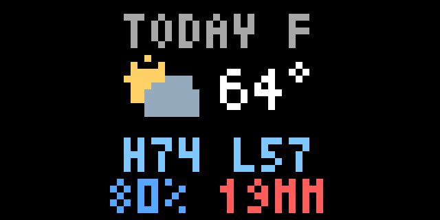

# Hourly Weather

Today's summary followed by four-column hourly forecast pages. Choose Fahrenheit or Celsius and the next 8 or 12 hours, including the current hour. Every page lasts 3.5 seconds. An unconfigured app defaults to Seattle.

The summary shows current conditions and temperature, daily high/low, maximum hourly precipitation probability, and the day's total rain. Hourly columns show local time, conditions, temperature, precipitation probability and rainfall in millimeters. Probability and mm are side by side on the summary. The current hourly label is gold.

Rain includes large-scale rain and convective showers, not snowfall. Amount colors indicate hourly rain rate: gray for zero, green below 2.5 mm/hour, yellow from 2.5 to below 10, and red at least 10. The summary uses the wettest hour's color. These simplified [WMO rain-rate bands](https://www.weather.gov/media/epz/mesonet/CWOP-WMO8.pdf) describe hourly averages, not brief instantaneous downpours. The percentage is precipitation probability (including snow), which is distinct from the rain-only amount.

Amounts below 10 mm use one decimal; larger amounts are rounded to whole mm. `<0.1` denotes trace rain and `999+` denotes an amount that rounds to at least 1,000 mm. The display's intensity is computed before rounding. Rainfall is always in mm, independent of the temperature unit. No L/M/H letters are displayed.

[Weather data by Open-Meteo](https://open-meteo.com/), [CC BY 4.0](https://creativecommons.org/licenses/by/4.0/). Data are rounded and represented by icons. Requests are cached for 15 minutes. Unix timestamps distinguish repeated DST hours, and precipitation at t+1 is associated with the interval beginning at t, following the [API's preceding-hour definitions](https://open-meteo.com/en/docs).

Non-200 HTTP responses and incomplete/stale weather render an unavailable screen. Pixlet v0.34.0 propagates transport and JSON-decoding errors to the host; Starlark cannot catch those. The free endpoint has shared-IP limits and no uptime guarantee. This is an independent non-monetized community app, assessed against the provider's [non-commercial terms](https://open-meteo.com/en/terms).

Validated on official Pixlet v0.34.0: `pixlet check`, 69 native fixture renders and 12 live configurations (Seattle/New York/Tokyo, both units, both forecast lengths). Digital output was visually reviewed at 64×32. Physical-device viewing-distance testing was not performed. The preview above is synthetic and demonstrates the rain colors.
