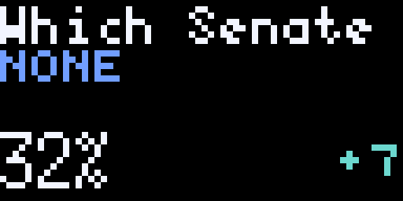

# Polymarket

A rotating display of live prediction markets. Trending is the default; each
card shows the question, leading contender, current price as a percentage, and
probability change. No account, API key, or separate backend is required.



The preview is a captured snapshot of the public API.

## Settings

- **Feed:** Trending or Breaking
- **Change:** day-over-day (default) or week-over-week, shown as `+6`, `-3`, `0`,
  or `--` when unavailable; changes are percentage points, not relative returns
- **Topics:** independent switches, all on by default, for politics/elections,
  sports/esports, crypto, finance/economy, world/geopolitics, technology/science,
  culture/entertainment, weather/climate, and other topics

Excluding a topic removes events tagged with it, including events that also
match an included topic. Other covers unrecognized or missing broad tags.
Classification follows API tags, so narrow filters may yield fewer markets.

## Selection and rotation

Trending considers the top 30 open events by 24-hour volume. Breaking combines
the top 40 positive and negative daily market movers, fetches complete details
for up to 24 unique events, then ranks by the displayed favorite's absolute
daily change. Weekly display does not change Breaking's daily ranking. These
API-based rankings may differ from the website.

For mutually exclusive outcomes, the contender with the highest valid Yes
price leads, including a genuine Other outcome. For independent questions
within one event (dates, thresholds, sports props), the highest-volume eligible
question is used. The more likely binary outcome is shown, with the change
sign inverted when displaying No or the second outcome.

Closed, resolved, finished, non-trading, and invalid markets are excluded.
Recognizable past UTC market deadlines are excluded conservatively; an event
container's deadline alone does not settle all its child questions. Quotes
that round to 99% or 100% are hidden: the raw cutoff is 98.5%. A near-certain
winner suppresses its race instead of promoting a losing runner-up.

Up to eight events are selected, with one per API series where available. Two
cards are shown per image. Every five-minute selection slot advances two places:
A/B, C/D, E/F, G/H for a stable eight-event pool. Selection advances on hosted
renders, not device appearances; the device can replay a pair between updates.

## Display and failures

Questions scroll at 20 pixels/second, with an opening pause and a one-second
end hold. Full favorites occupy two blue rows; longer names use stationary
pages with at least 3.5 seconds each. Numbers stay fixed. Cards last at least
7.5 seconds, extending to finish the text. `show_full_animation` requests full
hosted playback. Display strings are bounded at 180 characters.

Responses and normalized cards are cached for five minutes. Recoverable HTTP
or JSON failures can use a last-good result for up to 30 minutes, marked `OLD`.
Cached cards are rechecked against known deadlines. Empty successful responses
replace old results. Responses over 16 MB are rejected before JSON decoding,
although Pixlet's HTTP runtime still downloads the body. No external images
are loaded.

Pixlet v0.34.0 does not provide catchable transport errors or per-request
timeouts to Starlark. DNS/TLS/connection/runtime failures abort that render.
Device images expire via `max_age`: 30 minutes for fresh renders, five for
`OLD` renders. Settlement between API updates is not instantly observable.

## Verification

Use the Pixlet version in the repository's `PIXLET_VERSION` and Python 3.10+:

```sh
python3 -m pip install -r apps/polymarket/tests/requirements.txt
python3 apps/polymarket/tests/test_app.py --output /tmp/polymarket-tests
pixlet format apps/polymarket/polymarket.star --dry-run
pixlet lint apps/polymarket/polymarket.star
pixlet check apps/polymarket
pixlet render apps/polymarket -o /tmp/polymarket.webp
pixlet render apps/polymarket feed=breaking period=week -o /tmp/polymarket-breaking.webp
```

The offline suite executes the actual Starlark in Pixlet. A temporary harness
stubs HTTP/cache calls; small fixtures cover both feeds, entry-point settings,
topic exclusions, favorites, price/change parsing, resolution/deadline and
99% boundaries, equal rotation, HTTP errors, malformed/empty data, and cache
expiry. Required image assertions check 64x32 output, exact duration, complete
title/name coverage, stationary metrics, and the visible `OLD` indicator.
No production test modes or extra services are needed.

The extra tests are run locally with the command above. The repository's
existing PR workflow runs its normal `pixlet check`; this app adds no CI steps.

The author has also tested the app separately locally. The automated suite
verifies rendering and selection behavior; hosted playback and update cadence
are controlled by Tidbyt.

Data: [Polymarket events](https://docs.polymarket.com/api-reference/events/list-events)
and [markets](https://docs.polymarket.com/api-reference/markets/list-markets).
This is an independent community app.
